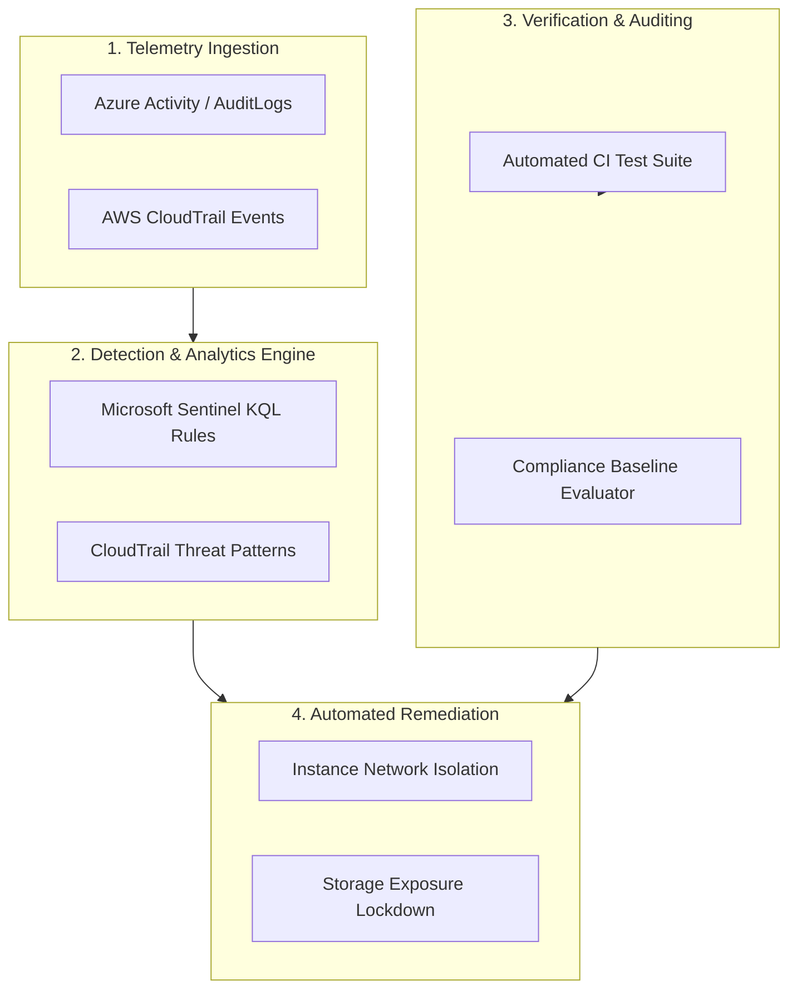

# Cloud Security Sentinel Suite

A modular cloud security engineering and threat detection suite built for Microsoft Sentinel and AWS cloud environments. It provides validated KQL queries, CloudTrail detection rules, automated response remediation scripts, and baseline compliance auditing.

---

## Architecture Overview



---

## Directory Structure

```text
cloud-security-sentinel-suite/
├── .github/workflows/
│   └── ci.yml                     # Automated GitHub Actions test pipeline
├── compliance/
│   └── cis_azure_benchmark_audit.py # Config audit against baseline standards
├── detections/
│   ├── azure/kql/                 # KQL queries mapped to MITRE ATT&CK
│   │   ├── compute/               # Run Command execution detection
│   │   ├── identity/              # PIM elevation & role assignment abuse
│   │   ├── network/               # Open NSG inbound exposure detection
│   │   └── storage/               # Blob public access configuration alerts
│   └── aws/cloudtrail/            # AWS security event detection rules
│       ├── iam_backdoor_user_keys.json
│       └── s3_bucket_policy_tampering.json
├── remediation/python/
│   ├── quarantine_compromised_instance.py # Compute isolation actions
│   └── remediate_storage_exposure.py      # Storage access remediation
├── tests/
│   ├── test_detection_syntax.py     # Syntax and metadata validation tests
│   └── test_remediation_modules.py  # Unit test suite for modules
├── requirements.txt
└── README.md
```

---

## Detection Rule Matrix

| Rule Name | Platform | Target Service | Severity | MITRE ATT&CK |
|---|---|---|---|---|
| Azure AD PIM Elevation Abuse | Azure | Entra ID / AuditLogs | High | T1078.004, T1098.003 |
| Storage Blob Public Exposure | Azure | Azure Storage | Medium | T1530, T1562.001 |
| VM Run Command Remote Exec | Azure | Azure Compute | Medium | T1059.001, T1021.002 |
| NSG Open Inbound 0.0.0.0/0 | Azure | Azure Virtual Network | High | T1190, T1046 |
| Unapproved IAM Access Keys | AWS | IAM | High | T1098.001, T1078.004 |
| S3 Wildcard Policy Modification | AWS | Amazon S3 | Critical | T1530, T1562.001 |

---

## Local Verification & Testing

Execute the test suite locally using standard Python:

```bash
python3 -m unittest discover -s tests -v
```

All detection files and remediation modules are validated on every push via GitHub Actions.
