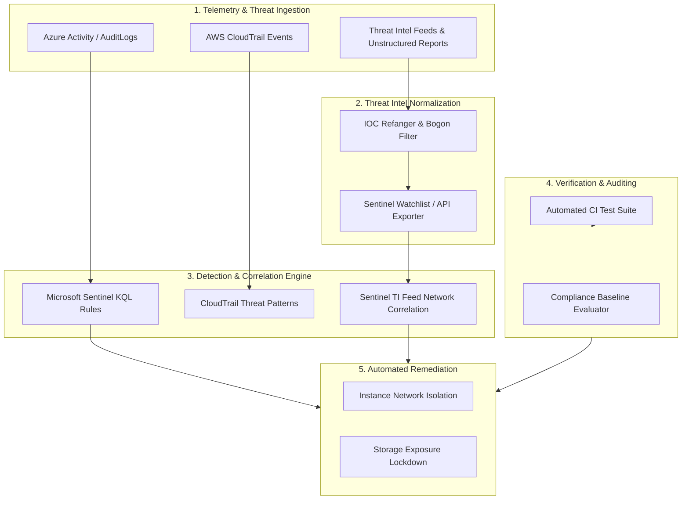

# Cloud Security Sentinel Suite

A modular cloud security engineering and threat detection suite built for Microsoft Sentinel and AWS cloud environments. It provides validated KQL queries, CloudTrail detection rules, automated response remediation scripts, baseline compliance auditing, and threat intelligence indicator parsing engines.

---

## Architecture Overview



---

## Directory Structure

```text
cloud-security-sentinel-suite/
├── .github/workflows/
│   └── ci.yml                     # Automated GitHub Actions test pipeline
├── compliance/
│   └── cis_azure_benchmark_audit.py # Config audit against baseline standards
├── detections/
│   ├── azure/kql/                 # KQL queries mapped to MITRE ATT&CK
│   │   ├── compute/               # Run Command execution detection
│   │   ├── identity/              # PIM elevation & role assignment abuse
│   │   ├── network/               # Open NSG inbound exposure detection
│   │   ├── storage/               # Blob public access configuration alerts
│   │   └── threat_intel/          # TI feed correlation with network telemetry
│   └── aws/cloudtrail/            # AWS security event detection rules
│       ├── iam_backdoor_user_keys.json
│       └── s3_bucket_policy_tampering.json
├── remediation/python/
│   ├── quarantine_compromised_instance.py # Compute isolation actions
│   └── remediate_storage_exposure.py      # Storage access remediation
├── threat_intel/
│   ├── __init__.py
│   └── ioc_threat_enricher.py     # IOC parser, defang/refang, and Sentinel exporter
├── tests/
│   ├── test_detection_syntax.py             # Syntax and metadata validation tests
│   ├── test_remediation_modules.py          # Unit test suite for remediation
│   └── test_threat_intelligence_enricher.py # Unit tests for TI parsing & export
├── requirements.txt
└── README.md
```

---

## Detection & Intelligence Rule Matrix

| Rule Name | Platform | Target Service | Severity | MITRE ATT&CK |
|---|---|---|---|---|
| Azure AD PIM Elevation Abuse | Azure | Entra ID / AuditLogs | High | T1078.004, T1098.003 |
| Storage Blob Public Exposure | Azure | Azure Storage | Medium | T1530, T1562.001 |
| VM Run Command Remote Exec | Azure | Azure Compute | Medium | T1059.001, T1021.002 |
| NSG Open Inbound 0.0.0.0/0 | Azure | Azure Virtual Network | High | T1190, T1046 |
| Microsoft Sentinel TI Network Match | Azure | ThreatIntelligence / CommonSecurityLog | High | T1071.001, T1573, T1043 |
| Unapproved IAM Access Keys | AWS | IAM | High | T1098.001, T1078.004 |
| S3 Wildcard Policy Modification | AWS | Amazon S3 | Critical | T1530, T1562.001 |

---

## Threat Intelligence Ingestion Engine

The `threat_intel.ioc_threat_enricher` module provides automated IOC parsing from raw threat feeds, defangs/refangs values, filters private/bogon IP addresses (RFC 1918), and generates:
1. **Microsoft Sentinel Watchlist CSV**: For joining against analytic rules with `$left.DestinationIP == $right.SearchKey`.
2. **Sentinel Threat Intelligence API Payloads**: Conforming to Microsoft Graph Security / ThreatIntelligenceIndicator entity models.

```python
from threat_intel.ioc_threat_enricher import ThreatIntelParser, TLPLevel

parser = ThreatIntelParser()
indicators = parser.extract_iocs_from_text(raw_report_text, tlp=TLPLevel.AMBER)
watchlist_csv = parser.export_sentinel_watchlist_csv(indicators)
```

---

## Local Verification & Testing

Execute the test suite locally using standard Python:

```bash
python3 -m unittest discover -s tests -v
```

All detection files, threat intelligence modules, and remediation modules are automatically validated on every push via GitHub Actions.
