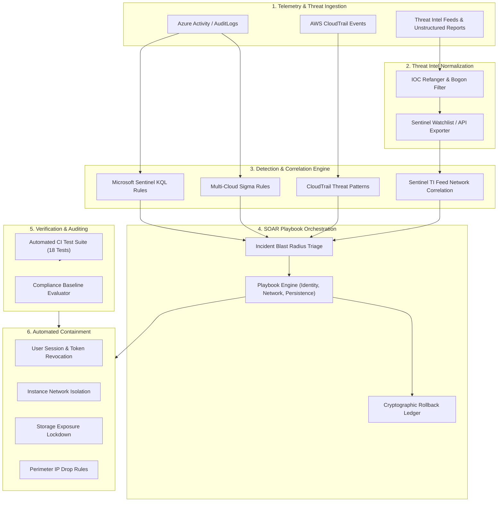

# Cloud Security Sentinel Suite

A modular cloud security engineering and threat detection suite built for Microsoft Sentinel and AWS cloud environments. It provides validated KQL queries, multi-cloud Sigma detection rules, CloudTrail alert patterns, a SOAR automated incident response playbook orchestrator, baseline compliance auditing, and threat intelligence indicator parsing engines.

---

## Architecture Overview



---

## Directory Structure

```text
cloud-security-sentinel-suite/
├── .github/workflows/
│   └── ci.yml                     # Automated GitHub Actions test pipeline
├── compliance/
│   └── cis_azure_benchmark_audit.py # Config audit against baseline standards
├── detections/
│   ├── azure/kql/                 # KQL queries mapped to MITRE ATT&CK
│   │   ├── compute/               # Run Command execution detection
│   │   ├── identity/              # PIM elevation & role assignment abuse
│   │   ├── network/               # Open NSG inbound exposure detection
│   │   ├── persistence/           # Service principal credential addition
│   │   ├── storage/               # Blob public access configuration alerts
│   │   └── threat_intel/          # TI feed correlation with network telemetry
│   ├── aws/cloudtrail/            # AWS security event detection rules
│   │   ├── iam_backdoor_user_keys.json
│   │   └── s3_bucket_policy_tampering.json
│   └── sigma/cloud/               # Multi-cloud Sigma detection rules
│       └── azure_service_principal_credentials_added.yml
├── remediation/python/
│   ├── quarantine_compromised_instance.py # Compute isolation actions
│   └── remediate_storage_exposure.py      # Storage access remediation
├── soar/
│   ├── __init__.py
│   └── incident_playbook_orchestrator.py  # SOAR automated response & rollback engine
├── threat_intel/
│   ├── __init__.py
│   └── ioc_threat_enricher.py     # IOC parser, defang/refang, and Sentinel exporter
├── tests/
│   ├── test_detection_syntax.py             # KQL, CloudTrail, & Sigma validation
│   ├── test_remediation_modules.py          # Unit test suite for remediation
│   ├── test_soar_playbook.py                # Unit test suite for SOAR playbooks
│   └── test_threat_intelligence_enricher.py # Unit tests for TI parsing & export
├── requirements.txt
└── README.md
```

---

## Detection & Intelligence Rule Matrix

| Rule Name | Format | Platform | Target Service | Severity | MITRE ATT&CK |
|---|---|---|---|---|---|
| Azure AD PIM Elevation Abuse | KQL | Azure | Entra ID / AuditLogs | High | T1078.004, T1098.003 |
| Service Principal Credential Addition | KQL | Azure | Entra ID / AuditLogs | High | T1098.001, T1136.003 |
| Service Principal Credential Addition | Sigma | Azure | Entra ID / AuditLogs | High | T1098.001 |
| Storage Blob Public Exposure | KQL | Azure | Azure Storage | Medium | T1530, T1562.001 |
| VM Run Command Remote Exec | KQL | Azure | Azure Compute | Medium | T1059.001, T1021.002 |
| NSG Open Inbound 0.0.0.0/0 | KQL | Azure | Azure Virtual Network | High | T1190, T1046 |
| Microsoft Sentinel TI Network Match | KQL | Azure | ThreatIntelligence / CommonSecurityLog | High | T1071.001, T1573, T1043 |
| Unapproved IAM Access Keys | JSON | AWS | IAM | High | T1098.001, T1078.004 |
| S3 Wildcard Policy Modification | JSON | AWS | Amazon S3 | Critical | T1530, T1562.001 |

---

## SOAR Automated Incident Response Playbook Engine

The `soar.incident_playbook_orchestrator` module provides production-ready automated triage, containment orchestration, and audit reporting for security incidents:

- **Dynamic Blast Radius Scoring**: Evaluates incident severity, entity count, and MITRE tactics to generate a composite impact score (1.0 to 10.0).
- **Execution Postures**:
  - `ExecutionMode.SIMULATION`: Safe preview calculating blast radius, proposed containment actions, and rollback payloads without modifying production cloud resources.
  - `ExecutionMode.LIVE`: Executes direct API containment actions against target cloud identities, networks, and compute workloads.
- **Built-in Playbooks**:
  1. `AccountCompromisePlaybook`: Invalidates Entra ID OAuth refresh tokens, enforces session termination, and notifies tier-2 SOC channels.
  2. `ThreatFeedNetworkIsolationPlaybook`: Injects perimeter firewall drop rules for malicious C2 destinations and binds zero-trust NSG isolation to communicating VMs.
  3. `ServicePrincipalPersistencePlaybook`: Disables unapproved client secrets/certificates attached to enterprise applications.
- **Cryptographic Rollback Ledger**: Every executed containment action generates a reversible SHA-256 rollback token for instant recovery upon false positives.

```python
from soar import SOAREngine, IncidentContext, IncidentEntity, EntityType, ExecutionMode

engine = SOAREngine()
incident = IncidentContext(
    incident_id="INC-SENTINEL-1029",
    title="Anomalous Entra ID Token Theft & Impossible Travel",
    severity="Critical",
    mitre_tactics=["Credential Access", "Privilege Escalation"],
    mitre_techniques=["T1550.001", "T1078.004"],
    entities=[
        IncidentEntity(EntityType.USER, "alex.hunter@corp.com", risk_weight=3.0),
        IncidentEntity(EntityType.IP_ADDRESS, "185.220.101.5", risk_weight=2.5),
    ],
    raw_alert_source="Microsoft Sentinel",
)

# Run triage and automated containment
reports = engine.triage_and_respond(incident, mode=ExecutionMode.LIVE)
markdown_brief = engine.generate_markdown_incident_report(incident, reports)
```

---

## Threat Intelligence Ingestion Engine

The `threat_intel.ioc_threat_enricher` module provides automated IOC parsing from raw threat feeds, defangs/refangs values, filters private/bogon IP addresses (RFC 1918), and generates:
1. **Microsoft Sentinel Watchlist CSV**: For joining against analytic rules with `$left.DestinationIP == $right.SearchKey`.
2. **Sentinel Threat Intelligence API Payloads**: Conforming to Microsoft Graph Security / ThreatIntelligenceIndicator entity models.

```python
from threat_intel.ioc_threat_enricher import ThreatIntelParser, TLPLevel

parser = ThreatIntelParser()
indicators = parser.extract_iocs_from_text(raw_report_text, tlp=TLPLevel.AMBER)
watchlist_csv = parser.export_sentinel_watchlist_csv(indicators)
```

---

## Local Verification & Testing

Execute the test suite locally using standard Python:

```bash
python3 -m unittest discover -s tests -v
```

All detection files, Sigma rules, threat intelligence modules, SOAR playbooks, and remediation modules are automatically validated on every push via GitHub Actions.
